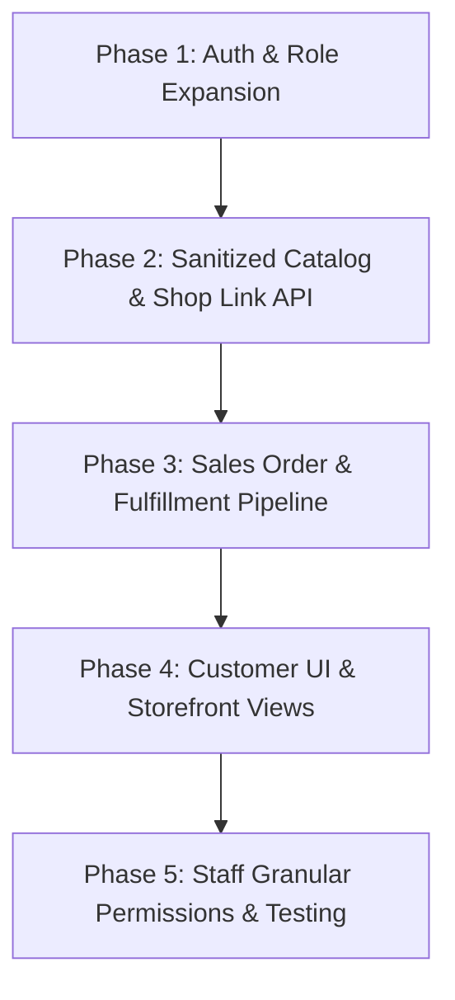

# Vyora Mobile & Multi-Role Commerce Architecture Plan
**Document Version:** 1.0.0  
**Target Platform:** Vyora Web (`vyora-frontend`) & Mobile (`vyora-mobile` via React Native / Expo) consuming `vyora-backend` (NestJS + MongoDB)  
**Author:** Senior System Architect & AI Engineering Team  
**Status:** Approved for Phased Implementation  

---

## 1. Executive Summary & Feasibility Assessment

### 1.1 Is this achievable with Vyora's current architecture?
**Verdict:** **YES, 100% FEASIBLE.**  
Vyora's current architecture is already decoupled into a modular monolith (`vyora-backend`) with MongoDB Mongoose schemas isolated strictly by `businessId`. 

The current system already contains:
1. Multi-tenant business partitioning (`businessId`).
2. Dual-level authorization: `User` and `Membership` (`OWNER`, `STAFF`, `ADMIN`).
3. Party Ledger (`Party` collection with `type: 'CUSTOMER' | 'SUPPLIER'`, phone numbers, billing/shipping addresses, and balance tracking in minor units).
4. Full product catalog with `sellingPriceMinor`, `currentStock`, and GST tax rates.
5. Invoicing and payment receipt engine.

### 1.2 Core Architectural Enhancements Required
To deliver the requested mobile flow, we expand the existing foundations in three specific areas:
1. **Multi-Role / Multi-Case Persona Engine**: A single authenticated user (e.g., via Phone Number) can hold different personas:
   - **Owner**: Full administrative control over their business(es).
   - **Staff**: Restricted access to specific operations (POS billing, stock lookup) configured by the Owner.
   - **Customer**: A streamlined shopping and ledger experience. No business dashboards, no inventory management; only browsing connected shops, viewing prices, checking stock availability (In Stock / Out of Stock without revealing warehouse counts), placing orders, and reviewing their khata/bills.
2. **Customer Storefront & Catalog Sanitization API**: Public/Customer endpoints that strip merchant-sensitive data (such as `purchasePriceMinor`, `reorderLevel`, `openingStock`, exact warehouse stock quantity) and project only `inStock: boolean`, `sellingPriceMinor`, `unit`, `name`, `sku`, and description.
3. **B2B Order-to-Invoice Pipeline**: Customers place orders &rarr; Merchant receives real-time order alert &rarr; 1-click acceptance and automatic conversion into a GST Sales Invoice with inventory deduction.

---

## 2. Multi-Role User Flow & Use Cases

```
                                 ┌─────────────────────────────────┐
                                 │      Unified Authentication     │
                                 │    (Phone OTP / Email+Password) │
                                 └────────────────┬────────────────┘
                                                  │
                                                  ▼
                                 ┌─────────────────────────────────┐
                                 │     Identity & Persona Router   │
                                 │     Inspects Active Persona     │
                                 └───────┬────────┬────────┬───────┘
                                         │        │        │
                   ┌─────────────────────┘        │        └─────────────────────┐
                   ▼                              ▼                              ▼
      ┌─────────────────────────┐   ┌───────────────────────────┐   ┌─────────────────────────┐
      │       OWNER FLOW        │   │        STAFF FLOW         │   │      CUSTOMER FLOW      │
      ├─────────────────────────┤   ├───────────────────────────┤   ├─────────────────────────┤
      │ • Full Admin Control    │   │ • Granular Permissions    │   │ • Zero Merchant Setup   │
      │ • Sales & Purchases     │   │ • Fast Mobile POS Billing │   │ • My Connected Shops    │
      │ • Stock & Reorder Levels│   │ • Stock Lookup (Read-Only)│   │ • Shop Catalog Browsing │
      │ • P&L & GST Reports     │   │ • Online Order Dispatch   │   │ • In-Stock (No Qty Seen)│
      │ • Staff & Roles Config  │   │ ✗ No Profit/Loss Reports  │   │ • Cart & Order Placement│
      │ • Accept Customer Orders│   │ ✗ No Bank/UPI Changes     │   │ • View Bills & Balances │
      └─────────────────────────┘   └───────────────────────────┘   └─────────────────────────┘
```

### 2.1 Use Case 1: Owner Flow (Full Access)
- **Registration**: Signs up, sets business trade name, GSTIN, and default tax rates.
- **Operations**:
  - Creates products and records purchase bills (which increment stock).
  - Sends staff invitations with granular toggles (e.g., "Allow POS Billing", "Allow Viewing Stock", "Hide Purchase Costs").
  - Views incoming customer orders placed via the mobile app, with options to **Accept & Finalize to Invoice** or **Reject**.
  - Accesses full financial reports, profit/loss, GST registers, and audit logs.

### 2.2 Use Case 2: Staff Flow (Role-Based Access Control)
- **Invitation & Onboarding**:
  - Owner enters staff phone number/email and assigns module permissions.
  - Staff logs in; the system loads their assigned business under the restricted `STAFF` role.
- **Operations**:
  - Can quickly punch counter sales / invoices from mobile.
  - Can look up product availability.
  - Restricted from viewing financial analytics, purchase margins, party ledger adjustments, or altering shop settings.

### 2.3 Use Case 3: Customer Flow (Storefront & Khata)
- **Zero Merchant Clutter**:
  - Customers do **not** see analytics, inventory reordering, expense logs, or merchant settings.
  - Automatically linked to shops where their phone number matches an existing `Party` record.
- **Shop Discovery & Connecting**:
  - **Auto-Linked**: If "Sharma Kirana" already created an invoice for `+91 98765 43210`, that shop automatically appears under the customer's "My Shops" tab.
  - **Manual Search**: Customer can search for new suppliers/retailers using the **Owner's Phone Number** or **Business Name** or by scanning a **Shop QR Code**.
  - **Connect Request**: One-tap "Connect to Shop" links the customer to the merchant's catalog.
- **Catalog Browsing & Stock Invariant**:
  - **What Customer Sees**:
    - Product Name, Photo/Thumbnail, SKU, Unit (e.g. PKT, KG, PCS).
    - Selling Price (including/excluding tax breakdown).
    - Availability Badge: `In Stock` (Green) or `Out of Stock` (Gray).
  - **What Customer NEVER Sees (Strict Privacy Rule)**:
    - Exact warehouse quantity (e.g., "342 items in godown" is completely masked).
    - Purchase cost / merchant profit margins.
    - Reorder levels or supplier names.
- **Cart & Order Placement**:
  - Add items to order basket.
  - Set required order quantity.
  - Review total estimated amount (in minor units converted to readable currency).
  - Add optional delivery instructions/notes.
  - Click **Place Order** &rarr; Generates a trackable B2B Sales Order.
- **Order Tracking & Digital Khata (Passbook)**:
  - Track order progress: `Placed` &rarr; `Accepted` &rarr; `Packed` &rarr; `Invoiced / Delivered`.
  - View all historical GST invoices and payment receipts issued by that shop.
  - Check outstanding balance: "Payable: ₹1,250" with an optional "Pay via UPI" button triggering PhonePe / Google Pay / Paytm.

---

## 3. High-Value Architectural Improvements (Senior Recommendations)

1. **Auto-Link via Phone Number (Zero-Friction Khata)**:
   - When a merchant creates an invoice or customer party with phone `9876543210`, the customer is linked in the background. The moment the customer downloads the Vyora app and verifies their phone number, the shop and all previous invoices appear immediately without manual pairing.
2. **Unified Account with Persona Switcher**:
   - In the Indian B2B landscape, a small business owner is often simultaneously a retailer for consumers and a customer of a wholesale distributor.
   - Rather than requiring two accounts or two apps, a single identity holds multiple memberships:
     - "My Business: Sharma Hardware" (Role: `OWNER`)
     - "Connected Supplier: Tata Steel Depot" (Role: `CUSTOMER`)
   - An intuitive persona switcher in the header/drawer allows instant switching.
3. **Public Digital Catalog Link & QR Code**:
   - Every merchant gets a unique shareable slug (e.g., `vyora.in/shop/sharma-supplies`).
   - Merchants can print this QR code at their checkout counter or share the link on WhatsApp. Unregistered customers can view the live catalog in their mobile browser and install the app to order.
4. **Resilient Offline POS Mode**:
   - In mobile environments with intermittent connectivity, counter billing must not stop. Use local storage / SQLite in React Native for rapid offline caching of products and pending transactions.

---

## 4. Database Schema Specifications

### 4.1 Enhanced `User` Schema
```typescript
@Schema({ timestamps: true })
export class User {
  @Prop({ required: true, trim: true })
  name: string;

  @Prop({ lowercase: true, trim: true, sparse: true, index: true })
  email?: string;

  @Prop({ required: true, unique: true, trim: true, index: true })
  phone: string; // E.164 formatted (e.g., "+919876543210")

  @Prop({ default: false })
  phoneVerified: boolean;

  @Prop()
  passwordHash?: string;

  @Prop({ type: [String], enum: ['OWNER', 'STAFF', 'CUSTOMER', 'ADMIN'], default: ['CUSTOMER'] })
  roles: UserRole[];

  @Prop({ type: String, ref: 'Business' })
  defaultBusinessId?: string;

  @Prop()
  avatarUrl?: string;
}
```

### 4.2 Enhanced `Membership` Schema (Granular Staff RBAC)
```typescript
export type StaffPermission =
  | 'POS_CREATE_INVOICE'
  | 'POS_VIEW_INVOICES'
  | 'INVENTORY_VIEW_STOCK'
  | 'INVENTORY_ADJUST_STOCK'
  | 'PARTIES_VIEW'
  | 'PARTIES_MANAGE'
  | 'ORDERS_MANAGE'
  | 'REPORTS_VIEW';

@Schema({ timestamps: true })
export class Membership {
  @Prop({ required: true, type: String, ref: 'User', index: true })
  userId: string;

  @Prop({ required: true, type: String, ref: 'Business', index: true })
  businessId: string;

  @Prop({ type: String, required: true, enum: ['OWNER', 'STAFF'], default: 'STAFF' })
  role: 'OWNER' | 'STAFF';

  @Prop({ type: [String], default: ['POS_CREATE_INVOICE', 'INVENTORY_VIEW_STOCK'] })
  permissions: StaffPermission[];

  @Prop({ type: Boolean, default: true })
  isActive: boolean;
}
```

### 4.3 `CustomerShopLink` Schema (Connecting Customers to Merchants)
```typescript
export type LinkStatus = 'ACTIVE' | 'PENDING' | 'BLOCKED';

@Schema({ timestamps: true })
export class CustomerShopLink {
  @Prop({ required: true, type: String, ref: 'User', index: true })
  customerId: string; // The User ID of the customer

  @Prop({ required: true, type: String, ref: 'Business', index: true })
  businessId: string; // The merchant business ID

  @Prop({ type: String, ref: 'Party', index: true })
  partyId?: string; // Matching internal Party record in the merchant's ledger

  @Prop({ type: String, enum: ['ACTIVE', 'PENDING', 'BLOCKED'], default: 'ACTIVE' })
  status: LinkStatus;

  @Prop({ default: false })
  isFavorite: boolean;
}
CustomerShopLinkSchema.index({ customerId: 1, businessId: 1 }, { unique: true });
```

### 4.4 `SalesOrder` Schema (Customer Orders)
```typescript
export type OrderStatus =
  | 'PLACED'
  | 'ACCEPTED'
  | 'PACKED'
  | 'DISPATCHED'
  | 'CONVERTED'
  | 'CANCELLED'
  | 'REJECTED';

@Schema({ _id: false })
export class OrderLineItem {
  @Prop({ required: true, type: String, ref: 'Product' })
  productId: string;

  @Prop({ required: true })
  productName: string;

  @Prop({ required: true })
  sku: string;

  @Prop({ required: true })
  unit: string;

  @Prop({ required: true, min: 1 })
  quantity: number;

  @Prop({ required: true })
  unitPriceMinor: number; // In paisa

  @Prop({ required: true, default: 0 })
  taxRatePercent: number;

  @Prop({ required: true })
  totalMinor: number;
}

@Schema({ timestamps: true })
export class SalesOrder {
  @Prop({ required: true, unique: true, index: true })
  orderNumber: string; // e.g., "ORD-00101"

  @Prop({ required: true, type: String, ref: 'Business', index: true })
  businessId: string;

  @Prop({ required: true, type: String, ref: 'User', index: true })
  customerId: string;

  @Prop({ type: String, ref: 'Party', index: true })
  partyId?: string;

  @Prop({ type: [OrderLineItem], required: true })
  items: OrderLineItem[];

  @Prop({ required: true, default: 0 })
  subtotalMinor: number;

  @Prop({ required: true, default: 0 })
  taxMinor: number;

  @Prop({ required: true, default: 0 })
  grandTotalMinor: number;

  @Prop({
    type: String,
    enum: ['PLACED', 'ACCEPTED', 'PACKED', 'DISPATCHED', 'CONVERTED', 'CANCELLED', 'REJECTED'],
    default: 'PLACED',
    index: true,
  })
  status: OrderStatus;

  @Prop({ type: String, ref: 'Invoice' })
  convertedInvoiceId?: string;

  @Prop()
  customerNotes?: string;

  @Prop()
  merchantNotes?: string;
}
```

---

## 5. API Endpoint Architecture

### 5.1 Authentication & Persona Switcher
| Method | Endpoint | Access | Purpose |
| :--- | :--- | :--- | :--- |
| `POST` | `/api/v1/auth/otp/send` | Public | Send 6-digit SMS/WhatsApp OTP to phone number |
| `POST` | `/api/v1/auth/otp/verify` | Public | Verify OTP, register or login user, return JWT tokens |
| `GET` | `/api/v1/auth/personas` | Authenticated | List all personas for user: owned shops, staff roles, customer links |
| `POST` | `/api/v1/auth/select-context` | Authenticated | Issue role-scoped context token (Merchant Mode vs Customer Mode) |

### 5.2 Customer Storefront APIs
| Method | Endpoint | Access | Purpose |
| :--- | :--- | :--- | :--- |
| `GET` | `/api/v1/customer/shops` | Customer | List connected shops with ledger balances & active order count |
| `GET` | `/api/v1/customer/shops/search` | Customer | Search shops by merchant phone number or trade name |
| `POST` | `/api/v1/customer/shops/connect` | Customer | Send link request to merchant or auto-link via phone |
| `GET` | `/api/v1/customer/shops/:businessId/catalog` | Customer | **Sanitized Catalog**: Returns name, price, unit, and `inStock: boolean` (Strictly hides warehouse quantities) |
| `POST` | `/api/v1/customer/orders` | Customer | Submit a new order to the specified shop |
| `GET` | `/api/v1/customer/orders` | Customer | List customer's placed orders across all shops |
| `GET` | `/api/v1/customer/orders/:id` | Customer | Get order status, line items, and fulfillment history |
| `GET` | `/api/v1/customer/shops/:businessId/ledger` | Customer | View statement of invoices, payments, and net due amount |

### 5.3 Merchant Order Management APIs
| Method | Endpoint | Access | Purpose |
| :--- | :--- | :--- | :--- |
| `GET` | `/api/v1/orders` | Owner / Staff (with `ORDERS_MANAGE`) | List incoming customer orders |
| `PATCH` | `/api/v1/orders/:id/status` | Owner / Staff | Update order status (`ACCEPTED`, `PACKED`, `REJECTED`) |
| `POST` | `/api/v1/orders/:id/convert-to-invoice` | Owner / Staff (with `POS_CREATE_INVOICE`) | Convert order into finalized GST Invoice & decrement stock |

### 5.4 Staff Management & Granular RBAC
| Method | Endpoint | Access | Purpose |
| :--- | :--- | :--- | :--- |
| `GET` | `/api/v1/business/staff` | Owner | List team members with active permissions |
| `POST` | `/api/v1/business/staff/invite` | Owner | Invite staff member by phone/email with selected permissions |
| `PUT` | `/api/v1/business/staff/:id/permissions`| Owner | Update staff permissions or revoke access |

---

## 6. Frontend & Mobile UI Breakdown

### 6.1 Customer View Architecture (`/customer/*`)
- **Bottom Navigation Bar (Mobile)**:
  1. **Shops (`/customer/shops`)**: Card list of all linked shops showing Shop Name, Owner Phone, City, Balance Pill ("₹0 Due" or "₹450 Due"), and "Browse Catalog" CTA.
  2. **Catalog / Store (`/customer/shop/:id/catalog`)**:
     - Sticky Header: Shop Name + Category filter pills + Search bar (300ms debounce).
     - Product Cards: Product Image, Title, Price in ₹ (minor to major formatted), In Stock badge, and `+ Add` stepper button.
     - Sticky Bottom Drawer: "X items in cart &bull; ₹Total" &rarr; View Cart.
  3. **Cart & Checkout (`/customer/cart`)**:
     - Line items with quantity increment/decrement.
     - Itemized total calculation.
     - Delivery address / notes input.
     - "Place Order" button.
  4. **Orders (`/customer/orders`)**:
     - Visual stepper for order fulfillment: `Placed &bull; Accepted &bull; Invoiced &bull; Delivered`.
     - Order details drawer with invoice download link.
  5. **Passbook / Ledger (`/customer/ledger/:shopId`)**:
     - Running balance summary card.
     - Filterable chronological list of Invoices and Receipts.
     - Download PDF button for each invoice.

### 6.2 Merchant View Architecture (`/merchant/*`)
- **Web & Mobile Parity**:
  - Existing web portal retains full management capabilities.
  - New **Mobile POS View** optimized for phones:
    - Big keypad / Quick-add item grid.
    - Floating order notification badge: "3 New Online Orders".
    - 1-tap order review and conversion to bill.
    - WhatsApp bill sharing integration (`https://wa.me/?text=...`).

---

## 7. Step-by-Step Implementation Roadmap



### Phase 1: Authentication & Role Engine Expansion
- [ ] **Task 1.1**: Update `UserRole` enum across backend and shared-types to include `'CUSTOMER'`.
- [ ] **Task 1.2**: Add `phone`, `phoneVerified`, and `roles` array to `User` schema.
- [ ] **Task 1.3**: Implement OTP verification service in `auth.service.ts` (with demo fallback for testing).
- [ ] **Task 1.4**: Create `GET /auth/personas` and context-switch endpoint for multi-role users.

### Phase 2: Sanitized Catalog & Shop Connection APIs
- [ ] **Task 2.1**: Create `CustomerShopLink` schema and repository in `modules/business`.
- [ ] **Task 2.2**: Implement `GET /customer/shops` and auto-linking logic that matches customer phone numbers to existing `Party` records.
- [ ] **Task 2.3**: Build `GET /customer/shops/:id/catalog` with strict field projection:
  - Output: `id`, `name`, `sku`, `unit`, `sellingPriceMinor`, `taxRatePercent`, `inStock` (`currentStock > 0`).
  - Strict omission: `purchasePriceMinor`, `reorderLevel`, `openingStock`, exact `currentStock`.
- [ ] **Task 2.4**: Create unit tests in backend ensuring 0% sensitive data leakage in customer catalog responses.

### Phase 3: Sales Order & Fulfillment Pipeline
- [ ] **Task 3.1**: Create `SalesOrder` schema in `modules/orders`.
- [ ] **Task 3.2**: Build `POST /customer/orders` endpoint with validation using minor-unit arithmetic.
- [ ] **Task 3.3**: Build merchant endpoints: `GET /orders`, `PATCH /orders/:id/status`.
- [ ] **Task 3.4**: Implement `POST /orders/:id/convert-to-invoice`:
  - Automatically verifies stock availability.
  - Generates official `Invoice` record.
  - Decrements product inventory via existing `InventoryService`.
  - Updates customer balance in `Party` ledger.
  - Marks `SalesOrder` as `CONVERTED`.

### Phase 4: Customer UI & Storefront Views (Frontend / Mobile)
- [ ] **Task 4.1**: Build `PersonaSwitchModal` / context switch header allowing dual-role users to toggle between Merchant Mode and Customer Mode.
- [ ] **Task 4.2**: Implement `CustomerShopsPage`:
  - Display connected shops with balance pills.
  - Search shop modal by Owner Phone or Business Name.
- [ ] **Task 4.3**: Implement `CustomerCatalogPage`:
  - Clean, mobile-first product grid/list.
  - Visual stock badges: Green "In Stock", Gray "Out of Stock".
  - Add-to-cart controls with instant responsive badge updates.
- [ ] **Task 4.4**: Implement `CustomerCartDrawer` and Order Confirmation screen.
- [ ] **Task 4.5**: Implement `CustomerOrdersPage` with live status tracking (`PLACED` &rarr; `ACCEPTED` &rarr; `CONVERTED`).
- [ ] **Task 4.6**: Implement `CustomerLedgerPage` displaying past GST invoices, receipts, and net outstanding balance.

### Phase 5: Staff Granular Permissions & Five-Layer Quality Certification
- [ ] **Task 5.1**: Add `permissions: StaffPermission[]` to `Membership` schema and DTOs.
- [ ] **Task 5.2**: Implement NestJS `PermissionsGuard` protecting sensitive routes.
- [ ] **Task 5.3**: Update Staff Invite modal in frontend with customizable permission checkboxes.
- [ ] **Task 5.4**: Execute complete 5-layer quality gates:
  - Strict Typecheck (`tsc --noEmit` across backend and frontend).
  - UI Invariant Audit (`pnpm run audit:ui` - Theme B, clean slate, icon-only table actions).
  - Automated QA Scenarios (`node scripts/qa-runner.js --module all`).
  - Pre-flight Release Gate (`pnpm run ship:check`).

---

## 8. Data Privacy & Business Security Guarantees

1. **Merchant Confidentiality**:
   - Customers can **never** access merchant margins, purchase bills, warehouse stock quantities, or other customers' information.
   - Catalog queries use strict projection `{ purchasePriceMinor: 0, currentStock: 0, openingStock: 0, reorderLevel: 0 }`.
2. **Strict Financial Integrity**:
   - All order calculations use minor units (paisa) to prevent floating-point discrepancies.
   - Taxes are computed using existing server-side rules.
3. **Owner Protection**:
   - Primary Owner immutability remains strictly enforced (HTTP 403 on demotion).
   - Staff permissions are evaluated on every incoming request.

---

## 9. Conclusion
This architecture enables Vyora to seamlessly expand from a merchant billing dashboard into a collaborative B2B commerce network. Merchants manage their enterprise, staff punch counter sales, and retail customers browse catalogs and place orders—all powered by a single, unified, high-performance platform.
